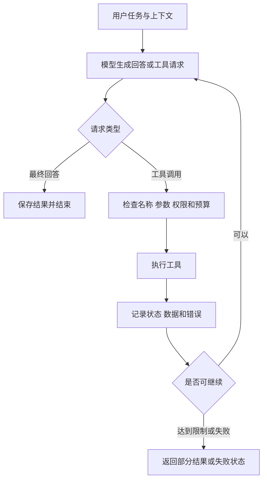

# 2026-10-15：Agent 范式与工具系统——代码点评及巩固笔记

适用读者：已初步学习 Python 与 Hello-Agent，希望把代码结构、Agent 范式和工具执行机制联系起来的学习者。

本文基于当天工作区的学习文件，以及本次命令所使用 Python 环境中的 hello-agents 1.0.1。IDE 若选择了其他解释器，包版本与接口应重新核对。本文记录纠正建议，不修改学习代码。

## 目录

1. [学习阶段判断](#学习阶段判断)
2. [先解决版本与接口问题](#先解决版本与接口问题)
3. [逐文件点评与纠正](#逐文件点评与纠正)
4. [四种 Agent 范式](#四种-agent-范式)
5. [Agent Runtime 的完整闭环](#agent-runtime-的完整闭环)
6. [工具系统的核心知识](#工具系统的核心知识)
7. [工具链、并发与状态](#工具链并发与状态)
8. [最小验证与练习顺序](#最小验证与练习顺序)
9. [主动回忆题与答案](#主动回忆题与答案)
10. [与长期方向的联系及来源](#与长期方向的联系及来源)

## 学习阶段判断

从新增代码能看出，你已经接触了四类 Agent 控制流程，也开始把工具注册、搜索回退、表达式计算、顺序编排和并发执行拆开学习。

可以确认的是：代码覆盖了这些知识主题。仅凭文件内容，不能确认你已能独立实现，也不能证明端到端流程已经运行成功。

当前最有价值的下一步，是把一个最小闭环完整跑通：输入问题 → 模型提出工具调用 → 校验参数 → 执行工具 → 返回结果 → 模型回答。随后再比较不同范式怎样组织这个闭环。

## 先解决版本与接口问题

### 当天核对到的事实

- Git 显示原 MyAgent.py 已删除，新增 my_SimpleAgent.py 及其他学习文件。这是检查前已有的变更。
- 当前命令所用环境安装 hello-agents 1.0.1。
- hello_agents 包存在，hello_agent 包不存在。
- 已安装包导出 ReActAgent、ReflectionAgent、PlanSolveAgent。
- HelloAgentsLLM.invoke 返回 LLMResponse，文本位于 .content；当前类没有 generate 方法。
- ToolRegistry.execute_tool 返回 ToolResponse，不是字符串。主要字段包括 status、text、data、error_info。
- 当前 ReActAgent 的实现没有你调用的 _parse_output、_parse_action、_parse_action_input 这三个旧式解析方法。

官方明确区分与教程正文对应的 learn_version 分支和当前 1.0.1 版本。参见 [HelloAgents 版本说明](https://github.com/jjyaoao/HelloAgents#-版本说明)。

### 建议选择一条学习路径

**当前阶段建议：优先使用与教程对应的学习版本，在独立虚拟环境里固定具体 commit 或发布版本。** 先理解教程中的运行链路。之后再专门做一次向 1.0.1 的迁移练习。

也可以继续使用 1.0.1，但需要整体适配导出名、构造器、模型响应、工具响应和运行机制。只改一处 import 通常不够。本次没有替换依赖或改变环境。

记住：教程版本、实际安装版本、IDE 解释器，是三个需要同时对齐的条件。

## 逐文件点评与纠正

下面将“代码能证明的错误”“离线验证结果”和“后续工程改进”分开说明。

### 1. 范式模块：导入、父类和构造器不一致

位置：

- [my_ReactAgent.py](../code/hello-agent-7/my_ReactAgent.py)，第 3、49、81～92 行。
- [my_PlanAndSolveAgent.py](../code/hello-agent-7/my_PlanAndSolveAgent.py)，第 3、48、55 行。
- [my_ReflectionAgent.py](../code/hello-agent-7/my_ReflectionAgent.py)，第 3、41 行。

问题与纠正：

- 三个模块使用 hello_agent，当前环境只有 hello_agents。
- Reflectionagent 大小写不正确；当前实际导出为 ReflectionAgent。
- PlanAndSolveAgent 不是当前已安装包的导出名，实际为 PlanSolveAgent。
- ReAct 父类的第三个位置参数是 tool_registry；你传入了 system_prompt，后续位置也错位。对照目标版本签名，使用明确的关键字参数。
- 当前版本没有被继承调用的三个文本解析方法。如果要复现教程文本 ReAct，就需要自己实现并验证解析器；若使用当前原生工具调用机制，则沿用其协议。

这类问题属于接口对齐，不说明你对范式概念理解错误。

### 2. 测试脚本：入口没有随重命名同步

- test_simple_agent.py:4 仍从已删除的 MyAgent 导入；当前实现位于 my_SimpleAgent.py。
- test_plan_solve_agent.py:4 导入 my_plan_solve_agent，但当前文件为 my_PlanAndSolveAgent.py。
- 同一测试第 13～16 行没有传入自定义构造器要求的 tool_registry；该参数在你的实现里又没有实际参与执行，需要决定“接入工具”还是“移除无用参数”。
- test_reflection_agent.py:42 使用 my_reflection_agent，与 my_ReflectionAgent.py 的实际拼写不同，需统一。
- 演示脚本主要打印结果，没有自动断言；test_reflection_agent.py 创建了 code_agent，却没有调用它，因此没有验证自定义提示词分支。

建议统一使用小写下划线文件名；类名使用驼峰形式。演示代码放入 main 函数，并用 if __name__ == "__main__": 保护入口，避免导入触发模型调用。

### 3. 模型与工具响应：能打印，不代表就是字符串

位置：my_SimpleAgent.py:56、93、130；my_ReactAgent.py:78；tool_chain_manager.py:49～52；async_tool_executor.py:69。

在 1.0.1 下：

- re.findall(pattern, response) 不能处理 LLMResponse；离线验证得到 TypeError。
- Message.content 需要字符串，不能直接假设模型响应对象可被当成文本保存。
- len(tool_response)、tool_response[:100] 不适用于当前 ToolResponse。
- Plan-and-Solve 与 Reflection 使用 llm.generate，当前类没有此方法。

纠正方向：

- 文本模型回复：读取 response.content。
- 工具回复：先检查 response.status，再使用 response.text 或 response.data。
- 给模型回传工具结果时，可以按需要使用 response.to_model_text()，保留状态与结构化信息。

不要在所有地方机械地加 str()：这样可能掩盖失败状态、错误信息和结构化数据。

### 4. 规划输出使用 eval：把模型文本变成代码执行

位置：[my_PlanAndSolveAgent.py](../code/hello-agent-7/my_PlanAndSolveAgent.py):72～79。

模型输出是不可信输入。eval 会执行其中的 Python 表达式，不能用于解析行动计划。

优先让模型输出 JSON，并依次检查：

1. 是否能解析为列表。
2. 列表是否非空，元素是否都是非空字符串。
3. 步数、每步长度是否在限制内。
4. 如步骤包含工具调用，工具是否允许、参数是否符合契约。

如果为了兼容教程而使用 ast.literal_eval，它也只适用于受限字面量，并需要输入大小限制；它不是任意输入都安全的资源隔离机制。参见 [Python ast.literal_eval 文档](https://docs.python.org/3.12/library/ast.html#ast.literal_eval)。

此外，你的规划器文字要求每步“独立”，更准确的说法是“职责清晰、可执行，依赖关系明确”。规划步骤往往恰恰需要前一步结果。

### 5. Plan-and-Solve：最后一个步骤不一定等于任务答案

位置：my_PlanAndSolveAgent.py:84～99。

- 超过 max_steps 的计划会被截断，但仍把最后已执行步骤的结果作为最终答案。
- 通过字符串 split("->") 提取结果，会在回答自身包含箭头时丢失内容。
- 没有最终汇总或完整性检查；只有当最后一步明确回答原问题时，才可能直接作为任务答案。
- tool_registry 被保存，却未在执行阶段调用；当前实现是多次模型生成，不具备所展示的工具执行闭环。
- current_history 是任务内步骤记录；没有 add_message，不能期望 get_history 自动包含完整对话。

建议用结构化步骤记录保存 description、result、status；区分 completed、partial、failed，再决定是否汇总、重规划或返回未完成状态。

### 6. Reflection：当前是一轮反思，不是迭代收敛

位置：[my_ReflectionAgent.py](../code/hello-agent-7/my_ReflectionAgent.py):62～78。

实现为固定的初稿 → 反馈 → 改写三次调用。即使反馈是“无需改进”，仍会调用改写阶段。也没有保存运行历史。

作为最小学习实现，一轮流程是合理起点，但应明确：

- “无需改进”可以成为提前结束条件。
- 循环反思需要最大次数、成本限制与明确评价标准。
- 反思意见可能错误；同一模型重复审查不会自动获得新的事实证据。
- 有测试、检索依据或工具反馈时，应使用外部证据验证改写质量。

### 7. 计算器：AST 白名单思路正确，校验尚不完整

位置：[my_calculator_tool.py](../code/hello-agent-7/my_calculator_tool.py):26～49。

已执行的离线结果：

| 输入 | 当前输出 | 说明 |
| --- | --- | --- |
| 2+2 | 4 | 基本加法可用 |
| sqrt(16) | 4.0 | 已支持函数可用 |
| -1+2 | 计算失败提示 | 缺少 UnaryOp / USub 支持 |
| abs(1) | 字符串 None | 未知函数没有显式报错 |
| foo | 字符串 None | 未知变量没有显式报错 |
| 'a'*3 | aaa | 常量未限制为数值 |
| 1/0 | 通用失败提示 | 除零原因被统一异常处理隐藏 |

纠正方向：

- 只接收明确允许的数值常量；bool 也需要单独排除。
- 对未知节点、变量、函数和运算符显式报错，不能默认返回 None。
- 明确是否支持负数；支持时增加一元运算白名单。
- 将函数和常量分别管理，例如 sqrt 属于函数，pi 属于常量。
- 不使用裸 except；区分格式错误、非法参数、除零等。
- 限制表达式长度、递归深度、数值规模。使用 AST 不等于已经解决所有安全与资源问题。

### 8. 高级搜索：实现的是按顺序回退，不是多源融合

位置：[my_advanced_search.py](../code/hello-agent-7/my_advanced_search.py):63～74、82～116。

离线模拟 Tavily 返回 {"results": []} 时：

- _search_with_tavily 仍返回“相关结果”标题。
- search 因字符串非空而认定成功。
- SerpAPI 分支没有被调用。

这说明“返回一个字符串”不足以判断搜索有效。应先检查原始结果是否存在，再格式化。

同时：

- 首个来源成功后立即返回，不会聚合其他来源，也没有质量评分，所以不能称为“最佳结果选择”。
- 返回内容缺少 URL，后续无法方便追溯证据。
- 创建 Tavily 客户端且未抛 ImportError，只能说明初始化条件满足，不能证明密钥和远程服务有效。
- 注册名为 advanced_search，实例名为 my_advanced_search，而工具链和并发示例调用 search；使用时必须统一注册契约。
- SerpAPI 的 GoogleSearch 是否可用取决于实际 SDK 发行包与版本，本次未联网调用该服务验证。

### 9. 工具链：上下游的输入输出契约没有衔接

位置：[tool_chain_manager.py](../code/hello-agent-7/tool_chain_manager.py):49～55、84～105。

离线使用返回字符串的模拟注册表验证：

- 搜索结果被插入“根据以下信息计算相关数值:...”。
- 这段自然语言直接传给只接受数学表达式的计算器。
- 计算失败。因此即使暂时避开版本问题，该链也不能正确完成预期流程。
- 空链访问 self.steps[-1]，抛出 IndexError。

此外，注释写“搜索 → 计算 → 总结”，实际只定义搜索与计算两步。工具失败也没有状态分支。

正确的数据衔接应类似：

搜索结构化事实 → 提取并验证数值 → 构造表达式 → 计算 → 汇总答案和来源。

其中数值提取可以是确定性代码，也可以使用模型，但模型输出仍需校验。不能把每个工具都当成能理解任意自然语言的 LLM。

context = context or {} 还会导致空字典被替换、非空字典被原地修改的不一致行为。学习阶段建议明确使用独立的每次执行上下文。

### 10. 异步执行器：并发结构成立，示例与生命周期待补齐

位置：[async_tool_executor.py](../code/hello-agent-7/async_tool_executor.py):14～45、48～69。

已有结构是：协程提交同步工具到线程池，再用 gather 收集结果。它适合并发等待阻塞式 I/O。

需要纠正和补充：

- 示例只创建了空 ToolRegistry，没有实际注册搜索和计算工具。
- 定义 async 测试函数不会自动运行；当前文件没有 asyncio.run 入口。
- 声明 List[str] 与 1.0.1 实际返回 ToolResponse 的类型不一致。
- gather 默认遇到未处理异常会向等待方传播；这不等于自动停止所有其他任务。
- 工具若把错误封装进 ToolResponse，gather 甚至不会抛异常，仍需逐项检查 status。
- gather 返回结果按提交顺序排列，不是完成顺序。
- 线程池最多同时运行 max_workers 个线程，不代表提交的任务总数被限制。
- 超时取消等待，不保证已经运行的线程或外部副作用立即停止。
- 不依赖 __del__ 及时释放资源；提供显式 close / 上下文管理，并在明确位置释放线程池。
- 并发访问共享注册表或工具客户端前，需要确认其线程安全性；本次未验证这一点。

这些并发语义参见 [Python 3.12 asyncio 文档](https://docs.python.org/3.12/library/asyncio-task.html#running-tasks-concurrently)。本次没有测量并发性能或运行真实外部工具。

## 四种 Agent 范式

范式主要描述“如何组织决策与执行”。它不是四种不同大模型，也不一定需要多个 Agent 实例。

| 范式 | 核心流程 | 适合的场景 | 主要风险 |
| --- | --- | --- | --- |
| SimpleAgent | 构造上下文 → 调用模型 → 保存回答；也可加入工具循环 | 简单问答、最小工具闭环 | 上下文遗漏、工具循环失控 |
| ReAct | 观察当前状态 → 决定行动 → 执行工具 → 接收观察 → 再决定 | 需要根据工具反馈动态探索的问题 | 调用格式错误、重复行动、达到步数上限 |
| Plan-and-Solve | 先规划 → 顺序执行步骤 → 汇总；必要时重规划 | 可分解、存在步骤依赖的任务 | 错误计划、执行失败仍继续、局部答案冒充完成 |
| Reflection | 初稿 → 依据标准评估 → 改写 → 停止或继续 | 可通过明确标准改善的代码或文档 | 自我确认、反思无依据、调用成本上升 |

几个应记住的区别：

- SimpleAgent 这个名字不保证“只能聊天”；是否有工具循环取决于具体实现和配置。
- ReAct 的关键是行动后把观察反馈给下一轮决策，不是打印 Thought 标签。
- Plan-and-Solve 的核心是显式任务分解；有计划不等于会执行工具。
- Reflection 的核心是反馈闭环；多改写一遍不等于事实更准确。
- 四种范式可以组合：规划某一步用 ReAct 执行，再用测试和 Reflection 改进结果。
- 教学中的 Thought 文本是显式生成的行动说明，不应视为可验证的模型内部思维或正确性证明。

## Agent Runtime 的完整闭环

LLM 负责提出回答或行动请求。Runtime 是你的程序，负责解释协议、校验、调度、维护状态和结束运行。

逐项理解：

1. **上下文构造**：系统要求、用户问题、相关历史、工具描述和已取得的证据。
2. **模型调用**：得到响应对象，解析明确字段。
3. **请求解析**：区分最终答案与行动；格式错误不能直接当成成功。
4. **工具执行**：查找注册项，校验参数，检查权限，调用真实函数。
5. **结果回传**：将工具状态与证据传回下一轮，保留调用对应关系。
6. **停止控制**：完成、步数上限、超时、预算不足、不可恢复错误分别处理。
7. **运行记录**：记录发生了什么，不把“模型说已完成”当作真实执行凭证。

你目前的文本标记 [TOOL_CALL:...] 和 tool[input] 都是自定义协议。模型写出这些文本后，仍由 Python 解析并真正调用工具。原生 Tool Calling 则通过专用的结构化调用字段交互，也仍然需要程序执行工具。

## 工具系统的核心知识

### 一个工具的最小契约

| 要素 | 需要回答的问题 |
| --- | --- |
| name | Runtime 用哪个稳定名称找到它？ |
| description | 模型何时应该调用，什么时候不该调用？ |
| input schema | 输入字段、类型、必填项与边界是什么？ |
| implementation | 真正执行的 Python 函数或服务是什么？ |
| output | 成功、失败、部分成功分别返回什么？ |
| execution policy | 权限、超时、重试、成本和副作用怎样控制？ |

ToolRegistry 的职责包括注册、查找、分发，以及具体实现提供的参数处理和响应包装。注册一个函数不会让它自动获得搜索能力，也不会让它自动理解自然语言。

你有两种接入方式：

- register_tool：注册遵守工具接口的对象，便于管理 schema 和完整生命周期。
- register_function：将普通函数暴露为工具。具体怎样传参数，必须看当前版本的注册与执行协议。

### 把文本与数据分开

搜索结果适合保留 title、url、snippet 等字段。计算结果适合保留数值、单位与表达式。展示给用户或模型的 text 是数据的表示，不应该成为唯一的数据载体。

这样工具链可以读取 result.data，而不必从“计算结果是 42”中重新猜测数值。

### 把成功与失败分开

“工具没有抛异常”“返回了非空字符串”“模型继续回答”，都不等于任务成功。

应区分：

- 调用协议是否正确。
- 工具是否真的执行。
- 工具是否返回有效数据。
- 原任务是否满足验收条件。

对于搜索，无结果、服务超时、权限失败是不同情况。对于计算器，输入不合法、除零与正常数值也应区分。

### 重试与副作用

搜索等读取操作通常较容易重试；发消息、写数据库、控制设备时，需要考虑重复执行的后果。先确定是否允许重试，以及如何识别已经执行过的同一次请求。

## 工具链、并发与状态

**顺序工具链**：后一步依赖前一步的结果。控制流由代码预先定义，属于 Workflow。

**动态 Agent**：由模型依据观察决定下一步做什么。

**并发执行**：用于同一阶段中彼此独立的任务。它与采用哪一种 Agent 范式是两个维度。

例如：

- 同时搜索两个独立资料来源：可以并发。
- 搜索数值后计算总价：计算依赖搜索，必须等数据就绪。
- Planner 把任务分成三步：不代表三步可以同时执行。

线程池常用于把阻塞式 I/O 放到工作线程，避免阻塞事件循环。对普通 Python CPU 密集型计算，不应假设线程池一定提升速度。

还要区分两类历史：

- current_history：当前一次任务内的工具观察、步骤结果或反馈。
- 对话历史 / 持久记忆：跨轮次或跨会话保留的信息。

列表里追加了一条记录，不等于下一次模型调用会看到它；必须在构造上下文时显式接入。当前 ReAct 会重置 current_history，也没有把已有对话历史放进提示词，因此不能把 get_history 的存在当作已具备多轮理解。

同样，stream_run 不必然与 run 功能一致。你目前的流式实现只进行文本生成，没有复用工具循环，因此不能认为启用工具后流式入口也能自动执行工具。

## 最小验证与练习顺序

### 本次实际完成的验证

- 对当前目录及 core 子目录的 12 个 Python 文件做 AST 语法解析，均可解析。
- 提取计算器函数做离线输入验证。
- 提取搜索类，用模拟客户端验证空结果回退。
- 提取工具链，用模拟注册表验证输入契约和空链行为。
- 使用已安装版本的独立 LLMResponse 定义验证“能打印但不能直接用于正则”。
- 查阅已安装包源码，核对导出名、构造器和响应类型。

没有直接导入会触发顶层模型调用的学习模块，没有调用真实模型、搜索 API 或执行 eval，也没有完成端到端 Agent 验证。语法解析通过不代表导入、运行或业务结果正确。

### 接下来按这个顺序练习

1. **先对齐环境**：确认 IDE 与命令使用同一解释器，选择教程版或当前版，记录版本。
2. **跑通计算器**：对正常输入、负数、未知名称、除零写出预期结果并验证。
3. **跑通单工具 Agent**：只注册计算器，观察“请求 → 执行 → 回传 → 回答”。
4. **验证错误路径**：不存在的工具、错误参数、达到步数限制。
5. **比较四种范式**：给它们同一道题，记录模型调用次数、工具调用次数、成功状态。
6. **修正工具链数据契约**：用固定模拟搜索结果完成数值提取、计算与汇总。
7. **再加并发**：验证独立任务、部分失败、结果顺序和资源关闭。
8. **最后接外部搜索**：保留来源 URL，再验证网络和 SDK 配置。

水果店题的数值基准为：周一 15、周二 30、周三 25，总计 70。除检查最终数字，还应确认执行步骤完整、没有把部分完成误报成功。

建议每次只修复一个层次，并保留失败样例。当前不急于同时扩展 Memory、MCP、RAG 或多 Agent。

## 主动回忆题与答案

先遮住答案，用自己的话回答；再对照代码讲一遍。

### 问题

1. 模型输出一个工具名后，谁真正执行这个工具？
2. ReAct 与固定工具链的控制流由谁决定？
3. 为什么 Plan-and-Solve 中的步骤不一定彼此独立？
4. Reflection 为什么可能把正确答案改错？
5. 为什么打印正常的 LLMResponse 不能直接交给 re.findall？
6. 搜索返回了非空文本，为什么仍可能是失败？
7. 为什么“搜索结果全文 → 计算器”不能直接接起来？
8. gather 返回值按任务完成顺序排列吗？
9. 等待超时后，线程中的写入操作一定停止了吗？
10. current_history 与长期 Memory 有什么区别？
11. 最大步骤数耗尽后，应返回哪一种任务状态？
12. 你准备怎样证明某个 Agent 改动确实更好？

### 对照答案

1. Runtime 查找并调用真实工具；模型只提出请求。
2. ReAct 由模型结合观察动态选择，固定工具链由代码预定义。
3. 后一步可能依赖前一步事实、数值或产物；必须显式表达依赖。
4. 反馈本身可能错误，且没有新证据；需要测试或外部依据。
5. 它是对象，打印依赖 __str__；正则需要字符串，应取 .content。
6. 格式化标题、错误提示也都是非空文本；应检查状态及实际数据。
7. 计算器要求表达式，需要先提取和验证数字，再构造输入。
8. 不是，按传入 awaitable 的顺序。
9. 不一定。取消等待不等于强制终止已经运行的线程或外部操作。
10. 前者是任务内状态；长期记忆需要明确的存储、检索和注入机制。
11. 应明确未完成或部分完成，不能伪装成正常完成。
12. 使用固定案例、正确答案、失败场景与成本记录，对比前后结果，而不只看输出是否流畅。

### 八句记忆卡

- 模型提出行动，程序负责执行。
- ReAct 看反馈再行动。
- Plan-and-Solve 先分解，再执行与汇总。
- Reflection 有反馈，但正确性仍要验证。
- 工具之间靠输入输出契约衔接。
- Workflow 预定义路径，Agent 动态决策。
- 并发需要独立性，超时不保证线程停止。
- 程序运行结束，不等于用户任务完成。

## 与长期方向的联系及来源

面向 Desk Butler、视觉感知和企业系统，可以逐步映射：

| 当前知识 | 后续应用 |
| --- | --- |
| ToolRegistry 与参数契约 | 摄像头读取、视觉推理、设备状态查询、业务系统接口 |
| ReAct | 根据感知结果决定下一次查询或操作 |
| Plan-and-Solve | 将较复杂的设备或业务任务分解为明确步骤 |
| Reflection 与评估 | 根据检测指标、测试和人工反馈改进输出 |
| 工具链与结构化结果 | 图像输入 → 视觉推理 → 结果校验 → 业务处理 |
| 并发与生命周期 | 并行查询独立设备，正确关闭连接和线程 |
| 权限、预算与完成状态 | 控制真实设备时区分“建议操作”“已执行”“执行成功” |

以上是后续练习方向，不代表当前代码已经具备相应能力。

参考：

- 本仓库 hello-agent/code/hello-agent-7/ 当天工作区文件。
- 本次 Python 环境中 hello-agents 1.0.1 的 __init__.py、core/llm.py、core/llm_response.py、agents/ 和 tools/registry.py、tools/response.py。
- [HelloAgents 官方仓库与版本说明](https://github.com/jjyaoao/HelloAgents)。
- [Python 3.12 asyncio：并发任务](https://docs.python.org/3.12/library/asyncio-task.html#running-tasks-concurrently)。
- [Python 3.12 ast.literal_eval](https://docs.python.org/3.12/library/ast.html#ast.literal_eval)。
